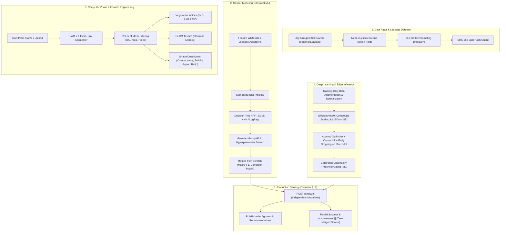

# Hydroponic Nutrition AI — Machine Learning Demo Preparation Guide

This guide maps **every machine learning concept** in the project to its **exact code location**, **line numbers**, **mathematical implementation**, and **live demo talking points**.

---

## 1. Data Leakage, Splitting & Validation Rigor

### Concept 1.1: Data Leakage & Grouped / Time-Based Separation
- **Code Location:**
  - Split Generator: [`scripts/make_sensor_validation.py`](file:///d:/Hydroponic-Nutrition-AI/scripts/make_sensor_validation.py#L43-L120)
  - Group-Aware CV: [`ml/evaluation/cv.py`](file:///d:/Hydroponic-Nutrition-AI/ml/evaluation/cv.py#L71-L150) (`GuardedGroupKFold`, `iterate_grouped_folds`)
  - Demonstration Notebook: [`notebooks/01_leakage_demo.ipynb`](file:///d:/Hydroponic-Nutrition-AI/notebooks/01_leakage_demo.ipynb)
- **Mathematical & Technical Formulation:**
  Sensor telemetry exhibits high temporal autocorrelation ($\rho(1) \approx 0.95$). If consecutive 10-minute sensor rows are partitioned randomly into train and test sets, models act as time interpolators and achieve artificial 100% test accuracy. The system enforces group separation:
  $$G(S_{\text{train}}) \cap G(S_{\text{val}}) = \emptyset, \quad G(S_{\text{train}}) \cap G(S_{\text{test}}) = \emptyset$$
  - Lettuce: Partitioned by discrete calendar day blocks (`day_index`).
  - Spinach: Partitioned into non-overlapping 6-hour contiguous blocks.
  - Tomato: Partitioned across distinct calendar months.
- **Assertion Guard:** [`assert_no_group_overlap`](file:///d:/Hydroponic-Nutrition-AI/ml/evaluation/cv.py#L42-L68) dynamically halts execution with `GroupOverlapError` if any group ID appears in both training and evaluation folds.
- **Demo Talking Point:** *"If you randomly split sensor telemetry, your model memorizes Tuesday at 2:00 PM and 2:10 PM, achieving 100% accuracy in lab benchmarks but completely collapsing when deployed on Wednesday. Our `GuardedGroupKFold` guarantees strict calendar-day extrapolation."*

---

### Concept 1.2: Near-Duplicate Detection across Image Splits
- **Code Location:**
  - Duplicate Auditor: [`scripts/find_duplicates.py`](file:///d:/Hydroponic-Nutrition-AI/scripts/find_duplicates.py#L40-L180)
  - Split Partitioning with Union-Find: [`scripts/make_image_splits.py`](file:///d:/Hydroponic-Nutrition-AI/scripts/make_image_splits.py#L49-L100) (`DisjointSetUnion`)
  - Manifest Outputs: [`processed_data/splits/image_splits_manifest.json`](file:///d:/Hydroponic-Nutrition-AI/processed_data/splits/image_splits_manifest.json)
- **Mathematical & Technical Formulation:**
  Public agricultural image datasets frequently contain burst shots of the same leaf with microscopic camera angle shifts. If burst photos cross the train/test divide, image classifiers simply memorize background glare.
  1. Exact duplicates detected via SHA-256 byte hashing.
  2. Perceptual near-duplicates detected via Difference Hashing (dHash, $8 \times 8$ gradient):
     $$\text{Hamming}(H_1, H_2) \le 4$$
  3. Connected components clustered using Union-Find (`DisjointSetUnion`) and placed as an indivisible atomic unit into the **same partition** (70% Train, 15% Val, 15% Test).
- **Demo Talking Point:** *"A model getting 98% on PlantVillage often just recognizes the same pot or camera scratch in both train and test. We clustered near-duplicates with dHash and Union-Find so that all clones stay strictly inside a single fold."*

---

### Concept 1.3: In-Fold Oversampling & Class Imbalance
- **Code Location:**
  - Fold Oversampling: [`ml/evaluation/cv.py`](file:///d:/Hydroponic-Nutrition-AI/ml/evaluation/cv.py#L210-L280) (`oversample_minority_classes`)
- **Mathematical & Technical Formulation:**
  Applying SMOTE or random oversampling **before** cross-validation synthesizes duplicate samples across folds, causing synthetic clone data leakage. In `evaluate_grouped_cv`, minority class resampling is executed strictly on $S_{\text{train\_fold}}$ **after** partitioning, ensuring the validation fold remains completely unadulterated:
  $$\text{Train}_{\text{fold}} \leftarrow \text{Resample}(\text{Train}_{\text{fold}}), \quad \text{Val}_{\text{fold}} \text{ untouched}$$
- **Demo Talking Point:** *"Resampling before splitting leaks future synthetic twins into your test fold. We enforce strict in-fold resampling so validation reflects true minority class prevalence."*

---

### Concept 1.4: Train/Serve Skew & Feature Availability (Live vs Lab Schemas)
- **Code Location:**
  - Schemas & Blacklists: [`ml/sensor_models/schemas.py`](file:///d:/Hydroponic-Nutrition-AI/ml/sensor_models/schemas.py#L292-L460) (`CropSensorSchema`, `TOMATO_LIVE_FEATURES`, `assert_no_leakage`)
- **Mathematical & Technical Formulation:**
  In laboratory datasets (e.g. Kolar tomato dataset), telemetry contains post-hoc chemical variables (Nitrate, Potassium ion sensors) that do not exist in live IoT greenhouse hardware.
  1. **Feature Schemas:** Enforces ordered feature vectors:
     - Tomato Live Schema: strictly 5 physical IoT features (`ec`, `ph`, `water_temp`, `tds`, `ambient_temp`).
     - Blacklist Patterns: Enforces regex filters against `*target*`, `*derived*`, `*label*`, `*severity*`.
  2. **Leakage Assertion:** [`assert_no_leakage`](file:///d:/Hydroponic-Nutrition-AI/ml/sensor_models/schemas.py#L418) executes prior to training; if an IoT model consumes an unobservable lab column, training immediately terminates with `DataLeakageError`.
- **Demo Talking Point:** *"A model trained on expensive wet-lab spectrometer columns cannot run on an ESP32 in a greenhouse. We built separate live-compatible schemas and runtime leakage assertions to prevent train/serve skew."*

---

### Concept 1.5: Cryptographic Split Integrity Hash Guard
- **Code Location:**
  - Split Guard Utility: [`ml/evaluation/split_guard.py`](file:///d:/Hydroponic-Nutrition-AI/ml/evaluation/split_guard.py#L66-L195) (`generate_split_hashes`, `assert_splits_intact`)
  - Checksum Manifest: [`processed_data/split_hashes.json`](file:///d:/Hydroponic-Nutrition-AI/processed_data/split_hashes.json)
- **Mathematical & Technical Formulation:**
  Every split CSV is hashed using SHA-256 upon generation. Before any training run or model promotion, [`assert_splits_intact`](file:///d:/Hydroponic-Nutrition-AI/ml/evaluation/split_guard.py#L180) verifies on-disk file bytes against the recorded hashes. Any manual edit, accidental overwrite, or re-split raises `SplitTamperError`.
- **Demo Talking Point:** *"In machine learning, subtle split drift ruins comparability. Every single dataset partition in this project is cryptographically signed and guarded by SHA-256 checksums."*

---

## 2. Sensor Modeling & Classical Machine Learning

### Concept 2.1: Decision Trees from Scratch & Gini Impurity
- **Code Location:**
  - From-Scratch Notebook: [`notebooks/02_gini_from_scratch.ipynb`](file:///d:/Hydroponic-Nutrition-AI/notebooks/02_gini_from_scratch.ipynb)
  - Scikit-Learn Training: [`ml/sensor_models/train_sensor.py`](file:///d:/Hydroponic-Nutrition-AI/ml/sensor_models/train_sensor.py#L77-L140) (`DecisionTreeClassifier`)
- **Mathematical & Technical Formulation:**
  Gini impurity for node $m$ with class distribution $p_{m, k}$:
  $$G(m) = 1 - \sum_{k=1}^{K} p_{m, k}^2$$
  The CART greedy split chooses feature $j$ and midpoint threshold $t$ maximizing Gini Gain:
  $$\Delta G(m, j, t) = G(m) - \left( \frac{N_L}{N_m} G(m_L) + \frac{N_R}{N_m} G(m_R) \right)$$
- **Demo Talking Point:** *"Decision trees provide transparent white-box agronomic rules (e.g. if EC > 2.8 and pH < 5.4, flag Potassium Toxicity). In notebook 02, we implemented the greedy Gini search from scratch to demonstrate the mathematical decision boundaries."*

---

### Concept 2.2: Classification Metrics from Scratch (Macro-F1, Confusion Matrix)
- **Code Location:**
  - Metric Engine: [`ml/evaluation/metrics.py`](file:///d:/Hydroponic-Nutrition-AI/ml/evaluation/metrics.py#L23-L130) (`calculate_metrics`, `calculate_classification_metrics`)
  - Verification Notebook: [`notebooks/03_metrics_from_scratch.ipynb`](file:///d:/Hydroponic-Nutrition-AI/notebooks/03_metrics_from_scratch.ipynb)
- **Mathematical & Technical Formulation:**
  In severely imbalanced agronomic datasets, raw accuracy is meaningless (a model predicting 100% 'Healthy' achieves 90% accuracy while plants starve to death).
  - Multi-class Confusion Matrix $C_{i, j}$ where rows are actual classes, columns are predicted classes.
  - Per-class Precision $P_k = \frac{TP_k}{TP_k + FP_k}$ and Recall $R_k = \frac{TP_k}{TP_k + FN_k}$.
  - Harmonic Mean: $F_{1, k} = \frac{2 P_k R_k}{P_k + R_k}$.
  - Unweighted Macro-Average:
    $$\text{Macro-F1} = \frac{1}{K} \sum_{k=1}^{K} F_{1, k}$$
- **Demo Talking Point:** *"Accuracy hides critical crop failure. We evaluate exclusively on Macro-F1, giving equal weight to rare deficiencies like Phosphorus starvation as we do to healthy majority foliage."*

---

### Concept 2.3: Random Forest: Bagging, Feature Subsampling & Variance Reduction
- **Code Location:**
  - Training Pipeline: [`ml/sensor_models/train_sensor.py`](file:///d:/Hydroponic-Nutrition-AI/ml/sensor_models/train_sensor.py#L90-L115) (`RandomForestClassifier`)
  - Feature Importance Artifacts: `reports/lettuce/feature_importances/`, `reports/tomato/feature_importances/`
- **Mathematical & Technical Formulation:**
  Random Forest reduces prediction variance by averaging $B$ decorrelated trees:
  $$\text{Var}(\bar{f}) = \rho \sigma^2 + \frac{1 - \rho}{B} \sigma^2$$
  Feature subsampling ($m = \sqrt{p}$) at every split decorrelates trees by reducing correlation coefficient $\rho$. Mean Decrease in Impurity (MDI) computes feature importance for agronomists.
- **Demo Talking Point:** *"A single tree overfits reservoir electrical spikes. Random Forest bags 100 trees with random feature subsets, reducing variance while outputting feature importance rankings for greenhouse operators."*

---

### Concept 2.4: Support Vector Machines (SVM): Hyperplane Margin, RBF Kernel & Mandatory Scaling
- **Code Location:**
  - Pipeline Builder: [`ml/sensor_models/train_sensor.py`](file:///d:/Hydroponic-Nutrition-AI/ml/sensor_models/train_sensor.py#L105-L115, #L164-L180) (`build_sensor_pipeline`, `StandardScaler`, `SVC(kernel='rbf')`)
- **Mathematical & Technical Formulation:**
  SVM finds maximal margin separating hyperplane subject to soft slack penalties:
  $$\min_{\mathbf{w}, b, \boldsymbol{\xi}} \frac{1}{2} \|\mathbf{w}\|^2 + C \sum_{i=1}^{N} \xi_i \quad \text{s.t.} \quad y_i (\mathbf{w}^T \phi(\mathbf{x}_i) + b) \ge 1 - \xi_i$$
  The Radial Basis Function (RBF) kernel maps inputs into infinite-dimensional Hilbert space:
  $$K(\mathbf{x}_i, \mathbf{x}_j) = \exp(-\gamma \|\mathbf{x}_i - \mathbf{x}_j\|^2)$$
  **Why Scaling Matters:** If EC ranges in $[0.5, 3.5]$ and TDS ranges in $[300, 2000]$, the Euclidean distance $\|\mathbf{x}_i - \mathbf{x}_j\|^2$ is completely dominated by TDS. `StandardScaler` inside the pipeline z-scores all features: $z = (x - \mu) / \sigma$.
- **Demo Talking Point:** *"Without z-score standardization, SVM treats an electrical conductivity shift from 1.0 to 2.5 mS/cm as negligible compared to raw TDS numbers in the thousands. Our `StandardScaler` lives inside the pickled pipeline, preventing serving skew."*

---

### Concept 2.5: Why Rule-Derived Synthetic Labels Inflate Model Scores
- **Code Location:**
  - Rule Definitions: [`ml/sensor_models/rules.py`](file:///d:/Hydroponic-Nutrition-AI/ml/sensor_models/rules.py#L146-L320) (`predict_lettuce_rule_label`, `compute_tomato_deviations`)
  - Comparative Audit Report: [`reports/analysis/tree_vs_rules.md`](file:///d:/Hydroponic-Nutrition-AI/reports/analysis/tree_vs_rules.md)
  - Recommendation Engine: [`ml/recommendations/rule_provider.py`](file:///d:/Hydroponic-Nutrition-AI/ml/recommendations/rule_provider.py#L75-L160)
- **Mathematical & Technical Formulation:**
  When dataset ground truth labels are generated by deterministic if-else rules (e.g. Kolar tomato proxy mappings), an axis-aligned Decision Tree achieves 100% accuracy simply by reverse-engineering Python boolean thresholds.
  - The project mandates flagging the tomato sensor model as `experimental = True` in [`ml/registry/registry.py`](file:///d:/Hydroponic-Nutrition-AI/ml/registry/registry.py).
  - In production, rule evaluation acts as an independent safety rail (`RuleProvider`) rather than replacing biological wet-chemistry verification.
- **Demo Talking Point:** *"When ML models achieve 100% on synthetic data, they haven't discovered plant biology; they've merely reverse-engineered software if-else rules. We explicitly document this in our report and tag the model as experimental."*

---

## 3. Computer Vision & Feature Engineering

### Concept 3.1: Colour Spaces (BGR vs RGB Bug) & Vegetation Indices (ExG, ExR)
- **Code Location:**
  - Feature Extractors: [`ml/features/common.py`](file:///d:/Hydroponic-Nutrition-AI/ml/features/common.py#L83-L140), [`ml/features/tomato.py`](file:///d:/Hydroponic-Nutrition-AI/ml/features/tomato.py#L178-L230)
  - Interactive Notebook: [`notebooks/04_color_spaces.ipynb`](file:///d:/Hydroponic-Nutrition-AI/notebooks/04_color_spaces.ipynb)
- **Mathematical & Technical Formulation:**
  1. **OpenCV BGR vs RGB:** OpenCV loads images in BGR order. Feeding BGR arrays to models transposes Blue and Red channels, inverting color signatures.
  2. **Normalized Chromaticity:**
     $$r = \frac{R}{R+G+B+\epsilon}, \quad g = \frac{G}{R+G+B+\epsilon}, \quad b = \frac{B}{R+G+B+\epsilon}$$
     Proved invariant to scalar uniform illumination changes: $g(\alpha R, \alpha G, \alpha B) = g(R, G, B)$.
  3. **Vegetation Indices:**
     - Excess Green: $\text{ExG} = 2g - r - b$ (chlorophyll detection).
     - Excess Red: $\text{ExR} = 1.4r - g$ (necrosis, anthocyanin, chlorosis).
- **Demo Talking Point:** *"Light changes constantly in greenhouses. By converting to normalized coordinates and computing Excess Green and Excess Red, our vision features isolate chlorophyll health from grow-light dimming."*

---

### Concept 3.2: Texture Features: GLCM Contrast and Entropy
- **Code Location:**
  - GLCM Engine: [`ml/features/glcm.py`](file:///d:/Hydroponic-Nutrition-AI/ml/features/glcm.py#L151-L245) (`compute_glcm`, `compute_glcm_contrast`, `compute_glcm_entropy`)
  - Integration: [`ml/features/spinach.py`](file:///d:/Hydroponic-Nutrition-AI/ml/features/spinach.py), [`ml/features/lettuce.py`](file:///d:/Hydroponic-Nutrition-AI/ml/features/lettuce.py)
- **Mathematical & Technical Formulation:**
  Second-order spatial statistics over quantized grayscale levels ($N=32$ bins, distance $d=1$, 4 angles $\theta \in \{0^\circ, 45^\circ, 90^\circ, 135^\circ\}$):
  $$P(i, j) = \frac{C_{\text{sym}}(i, j)}{\sum C_{\text{sym}}}$$
  - **Contrast:** $\sum_{i, j} |i - j|^2 P(i, j)$ (measures high-frequency surface roughness and necrotic lesion edges).
  - **Entropy:** $-\sum_{i, j} P(i, j) \log_2(P(i, j) + \epsilon)$ (measures mottled spatial randomness of chlorotic patches).
- **Demo Talking Point:** *"A healthy leaf has smooth texture and transitions concentrated on the diagonal ($i \approx j$). A leaf with fungal lesions or mottling scatters off-diagonal transitions, driving up GLCM Contrast and Entropy."*

---

### Concept 3.3: Shape Descriptors & The Droop Angle Decision
- **Code Location:**
  - Descriptors: [`ml/features/tomato.py`](file:///d:/Hydroponic-Nutrition-AI/ml/features/tomato.py#L114-L160) (`compute_shape_descriptors`), [`ml/features/lettuce.py`](file:///d:/Hydroponic-Nutrition-AI/ml/features/lettuce.py#L140-L165)
  - Droop Angle Review: [`reports/analysis/mask_review.md`](file:///d:/Hydroponic-Nutrition-AI/reports/analysis/mask_review.md)
- **Mathematical & Technical Formulation:**
  - **Compactness (Isoperimetric Quotient):** $\frac{4\pi A}{P^2} \in (0, 1.0]$ (scale-invariant measure of boundary roundness vs jagged necrotic edge tearing).
  - **Solidity:** $\frac{A}{A_{\text{convex}}} \in (0, 1.0]$ (detects margin wilting and deep nutrient burn indentations).
  - **Aspect Ratio:** $\frac{\max(w, h)}{\min(w, h)}$ from minimum area bounding rectangle.
  - **Droop Angle Decision (T5-006):** Droop angle in 2D top-down cameras was rejected because perspective foreshortening confounds vertical petiole droop with azimuthal leaf angle without calibrated stereo 3D depth.
- **Demo Talking Point:** *"We evaluated using 2D leaf droop angle to detect wilting, but discovered that top-down cameras confound droop with camera angle. We deliberately removed it to prevent perspective artifacts, relying instead on scale-invariant Compactness and Solidity."*

---

### Concept 3.4: Foundation Model Instance Segmentation (SAM 2.1)
- **Code Location:**
  - Segmenter Wrapper: [`ml/segmentation/sam2_segmenter.py`](file:///d:/Hydroponic-Nutrition-AI/ml/segmentation/sam2_segmenter.py#L74-L190) (`SAM2Segmenter`)
  - Mask Validation: [`ml/segmentation/mask_validation.py`](file:///d:/Hydroponic-Nutrition-AI/ml/segmentation/mask_validation.py#L90-L210) (`validate_mask`, `compute_mask_metrics`)
  - Leaf Extraction Pipeline: [`ml/segmentation/leaf_extraction.py`](file:///d:/Hydroponic-Nutrition-AI/ml/segmentation/leaf_extraction.py#L315-L420) (`extract_leaves`)
- **Mathematical & Technical Formulation:**
  Segment Anything Model (SAM 2.1 Hiera-Tiny) generates instance proposals using a dense prompt grid:
  1. Foreground filtering: Masks must exceed area threshold ($A \ge 500$ px) and bounding box boundaries ($W, H \ge 20$ px).
  2. Quality thresholds: Predicted $\text{IoU} \ge 0.70$, stability score across binarization thresholds $\ge 0.85$.
  3. Redundancy suppression: Pairwise mask intersection-over-union ($\text{IoU} \ge 0.50$) triggers non-maximum suppression (NMS) to eliminate duplicate leaf proposals.
- **Demo Talking Point:** *"Instead of brittle watershed edge detection, we utilize SAM 2.1 with prompt grids. Each extracted leaf is validated for hole fraction, boundary stability, and size before downstream classification."*

---

### Concept 3.5: Weak Labels & Multiple Instance Learning (MIL)
- **Code Location:**
  - Source Mapping: [`processed_data/lettuce_leaf_crops/source_map.csv`](file:///d:/Hydroponic-Nutrition-AI/processed_data/lettuce_leaf_crops/source_map.csv)
  - Label Review: [`reports/analysis/crop_label_review.md`](file:///d:/Hydroponic-Nutrition-AI/reports/analysis/crop_label_review.md)
  - Concept Note: [`docs/learning/weak-labels-and-instancelevel-perleaf-prediction.md`](file:///d:/Hydroponic-Nutrition-AI/docs/learning/weak-labels-and-instancelevel-perleaf-prediction.md)
- **Mathematical & Technical Formulation:**
  Whole-plant photos receive a bag label (e.g., 'Potassium Deficiency'). However, mobile nutrients affect older bottom leaves first while young upper leaves remain phenotypically green.
  - Training leaf models directly on whole-plant labels constitutes **weak supervision**.
  - In T5-012, 30 crops per class were manually inspected, documenting an inconsistency rate in `crop_label_review.md`.
  - In production, multi-leaf prediction outputs individual leaf classifications rather than averaging them into a fictitious score.
- **Demo Talking Point:** *"A potassium-deficient plant still has green leaves at the top. Averaging leaf predictions would mask early-stage deficiency. Our system presents per-leaf diagnosis so agronomists see exactly which leaves exhibit symptoms."*

---

## 4. Deep Learning, Neural Vision & Production Inference

### Concept 4.1: 2D Convolution, Max Pooling & Backprop from Scratch
- **Code Location:**
  - From-Scratch Notebook: [`notebooks/05_conv_from_scratch.ipynb`](file:///d:/Hydroponic-Nutrition-AI/notebooks/05_conv_from_scratch.ipynb)
  - Custom CNN Architecture: [`ml/image_models/custom_cnn.py`](file:///d:/Hydroponic-Nutrition-AI/ml/image_models/custom_cnn.py#L57-L140) (`CustomCNN`)
- **Mathematical & Technical Formulation:**
  - Forward 2D cross-correlation:
    $$Y(i, j) = \sum_{m} \sum_{n} X(i+m, j+n) K(m, n) + b$$
  - Backward pass loss gradients:
    $$\frac{\partial \mathcal{L}}{\partial K} = X * \frac{\partial \mathcal{L}}{\partial Y}, \quad \frac{\partial \mathcal{L}}{\partial X} = \frac{\partial \mathcal{L}}{\partial Y} * \text{rot}_{180^\circ}(K)$$
  - Max pooling routes gradients exclusively to the coordinate of maximum activation.
- **Demo Talking Point:** *"In notebook 05, we derived and implemented 2D spatial convolution and backpropagation adjoint rotations with pure NumPy before porting to PyTorch."*

---

### Concept 4.2: Training-Only Data Augmentation & Normalization
- **Code Location:**
  - Dataset & Transforms: [`ml/image_models/data.py`](file:///d:/Hydroponic-Nutrition-AI/ml/image_models/data.py#L134-L260, #L412-L460) (`CropLeafDataset`, `create_dataloaders`)
- **Mathematical & Technical Formulation:**
  - **Stochastic Training Pipeline:** Random horizontal and vertical flips ($p=0.5$), rotation $\mathcal{U}(-15^\circ, +15^\circ)$, and strictly bounded color jitter ($\text{hue} \le 0.02$).
  - **Agronomic Rule:** Extreme hue shifts ($\Delta H > 0.05$) are banned because altering hue turns yellow chlorosis into purple necrosis, corrupting ground truth.
  - **Evaluation Determinism:** Validation and test splits receive **zero** stochastic augmentations—only deterministic resizing and ImageNet standard normalisation ($z = (x - \mu)/\sigma$).
- **Demo Talking Point:** *"We never augment validation data. And during training, we bound color jitter strictly—otherwise random hue shifts would turn nitrogen deficiency (yellow) into phosphorus deficiency (purple)!"*

---

### Concept 4.3: Transfer Learning & Fine-Tuning (EfficientNetB0)
- **Code Location:**
  - Model Builder: [`ml/image_models/efficientnet.py`](file:///d:/Hydroponic-Nutrition-AI/ml/image_models/efficientnet.py#L89-L160, #L440-L480) (`EfficientNetB0`, `build_efficientnet_b0`)
  - Training Loop: [`ml/image_models/train_image.py`](file:///d:/Hydroponic-Nutrition-AI/ml/image_models/train_image.py#L209-L380) (`train_image_model`)
- **Mathematical & Technical Formulation:**
  1. Compound scaling ($d = \alpha^\phi, w = \beta^\phi, r = \gamma^\phi$) balances capacity at 5.3M parameters.
  2. Squeeze-and-Excitation (SE) channel attention:
     $$\mathbf{s} = \sigma\left(W_2 \cdot \text{SiLU}(W_1 \cdot \mathbf{z})\right)$$
  3. Fine-tuning strategy: ImageNet backbone weights frozen for head warm-up, followed by fine-tuning with differential learning rates ($\eta_{\text{head}} = 10^{-3}, \eta_{\text{backbone}} = 10^{-4}$) to prevent catastrophic forgetting.
  4. Early stopping on validation **Macro-F1** with patience 10.
- **Demo Talking Point:** *"EfficientNetB0 gives us ImageNet feature representations with only 5.3 million parameters. By using differential learning rates and early stopping on Macro-F1, we prevent the network from memorizing our small leaf dataset."*

---

### Concept 4.4: Softmax Overconfidence & Derived Per-Leaf Uncertainty Gating
- **Code Location:**
  - Uncertainty Threshold Thresholds: [`reports/calibration/uncertainty_thresholds.json`](file:///d:/Hydroponic-Nutrition-AI/reports/calibration/uncertainty_thresholds.json)
  - Threshold Extraction: [`scripts/derive_uncertainty_thresholds.py`](file:///d:/Hydroponic-Nutrition-AI/scripts/derive_uncertainty_thresholds.py)
  - Runtime Gating: [`backend/app/services/image_service.py`](file:///d:/Hydroponic-Nutrition-AI/backend/app/services/image_service.py#L272-L366)
- **Mathematical & Technical Formulation:**
  Raw softmax probabilities $\max_k \frac{e^{z_k}}{\sum_j e^{z_j}}$ are notoriously overconfident in deep vision models.
  - Uncertainty thresholds $\tau_{\text{mod}}$ and $\tau_{\text{high}}$ derived from empirical validation precision-recall curves.
  - If leaf confidence $p < \tau_{\text{mod}}$, `image_service.py` sets:
    $$\text{uncertain} = \text{True}$$
  - Alerts the operator that visual symptoms are ambiguous and require sensor confirmation.
- **Demo Talking Point:** *"Deep networks often output 90% confidence even on bizarre mistakes. We derived validation uncertainty thresholds; whenever a leaf falls below the threshold, the API explicitly marks it as `uncertain: true`."*

---

### Concept 4.5: Probability Calibration Decision (ADR 0009)
- **Code Location:**
  - Architectural Decision Record: [`docs/decisions/0009-probability-calibration.md`](file:///d:/Hydroponic-Nutrition-AI/docs/decisions/0009-probability-calibration.md)
  - Experiment Report: [`reports/calibration/calibration_experiment.json`](file:///d:/Hydroponic-Nutrition-AI/reports/calibration/calibration_experiment.json)
  - Reliability Plots: [`reports/calibration/t10_003_reliability_plots.png`](file:///d:/Hydroponic-Nutrition-AI/reports/calibration/t10_003_reliability_plots.png)
- **Mathematical & Technical Formulation:**
  Evaluated post-hoc Temperature Scaling on logits:
  $$p_i = \frac{\exp(z_i / T)}{\sum_j \exp(z_j / T)}$$
  Expected Calibration Error (ECE) was computed across 10 reliability bins. In ADR 0009, temperature scaling showed negligible ECE improvement over derived threshold gating for decision boundaries, establishing threshold-based uncertainty flags as the primary production gate.
- **Demo Talking Point:** *"In ADR 0009, we systematically tested temperature scaling on validation reliability diagrams. We decided on empirical threshold gating, preserving raw logits while explicitly warning agronomists when confidence drops."*

---

### Concept 4.6: Production Multimodal Fusion (Overview §19)
- **Code Location:**
  - Route Controller: [`backend/app/api/v1/analyze.py`](file:///d:/Hydroponic-Nutrition-AI/backend/app/api/v1/analyze.py#L82-L315) (`analyze`)
  - Schema Contract: [`backend/app/schemas/prediction.py`](file:///d:/Hydroponic-Nutrition-AI/backend/app/schemas/prediction.py) (`AnalyzeResponse`, `NotAssessedItem`)
- **Mathematical & Technical Formulation:**
  **The Anti-Patterns Forbidden by Canonical Overview §19:**
  - NO arbitrary score averaging: $\text{Conf}_{\text{merged}} \neq \frac{\text{Conf}_{\text{sensor}} + \text{Conf}_{\text{image}}}{2}$ (sensor and foliar symptoms operate on different physiological timescales).
  - NO fake 'contradiction' fields.
  - Independent modality execution with partial success tolerance: if the image camera fails, the sensor model still returns immediately, and `not_assessed[]` documents why the image was skipped.
- **Demo Talking Point:** *"Most naive multimodal systems take the average of sensor and vision confidence. That is biologically invalid—root EC stress happens in minutes, while leaf chlorosis takes days to show up. Our `POST /analyze` runs both modalities independently and reports missing inputs in `not_assessed[]` without artificial score blending."*

---

## 5. Live Demo Script (Step-by-Step)

| Step | Action | Endpoint / Command | Concepts to Highlight |
|---|---|---|---|
| **1** | Run Split Guard & Hash Check | `python scripts/verify_split_guard.py` | Day-based holdouts, Union-Find duplicate clustering, SHA-256 cryptographic guard. |
| **2** | Test Server-Side Sensor Prediction | `POST /api/v1/predict/sensor` with tomato readings | Ordered feature schemas, live IoT telemetry vs lab features, `StandardScaler` pipeline. |
| **3** | Test Foliar Leaf Mode Prediction | `POST /api/v1/predict/image` (`input_mode=leaf`) | Pretrained EfficientNetB0, normalized color spaces, training-only augmentation, uncertainty thresholds. |
| **4** | Test Multi-Leaf Whole Plant Extraction | `POST /api/v1/predict/image` (`input_mode=plant`) | SAM 2.1 Hiera-Tiny instance segmentation, mask IoU validation, weak label review, per-leaf reporting. |
| **5** | Test Full Multimodal Fusion | `POST /api/v1/analyze` | Partial success tolerance, independent modality outputs, `not_assessed[]`, zero merged scores (Overview §19). |
| **6** | Test Agronomic Rule Recommendations | Inspect `recommendation` object in `/analyze` response | Domain expert threshold rules (`RuleProvider`) providing transparent dosing advice. |
